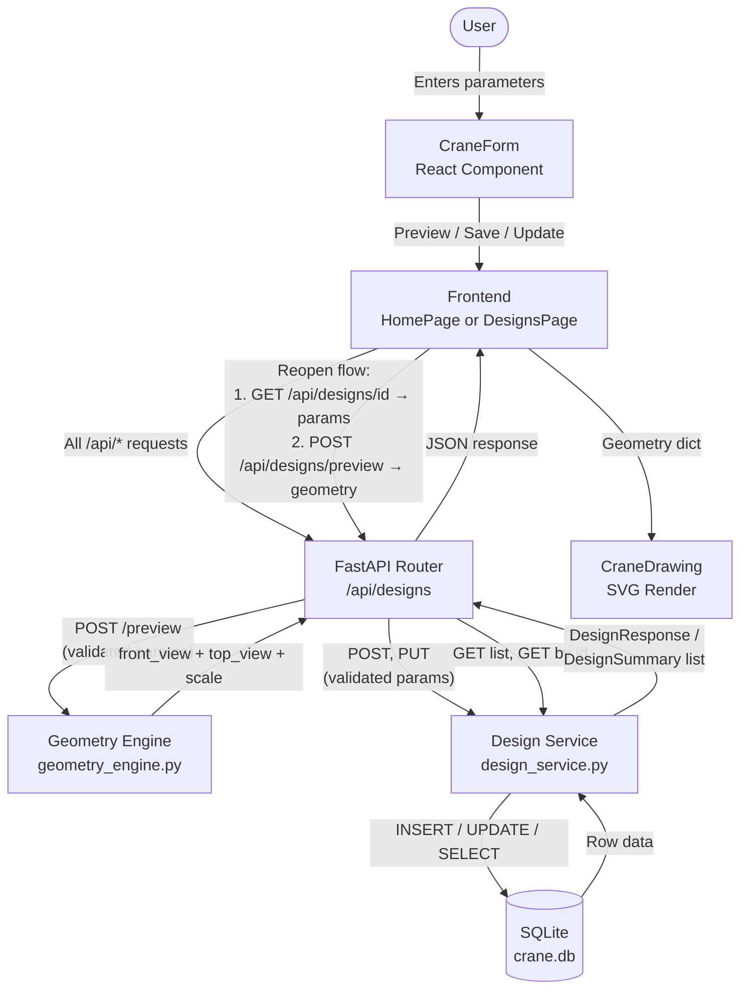

# Parametric Overhead Crane Drawing Generator

A take-home assignment submission for **Moderen Crane Co.**

---

## Overview

This application generates dimensioned parametric 2D drawings of an overhead crane from a small set of user-defined inputs. It is a **geometric drawing generator**, not a structural analysis or engineering calculation tool.

The user enters crane parameters — span, girder height, end truck length, lifting capacity, and maximum lift height — through a web form. The backend validates the inputs, computes SVG drawing coordinates, and returns a Front Elevation view and a Top (Plan) View. Both views share a common scale so proportions are consistent between them. Designs can be saved to a local SQLite database, listed, reopened, and updated.

**What it is:**
- A parametric 2D drawing tool that produces illustrative geometry from user inputs.
- A full-stack local web application with a React frontend and a Python/FastAPI backend.

**What it is not:**
- A structural engineering tool.
- A load calculation or safety analysis tool.
- A replacement for CAD software or certified crane engineering documents.

---

## Features

| Feature | Status |
|---|---|
| Crane parameter input form with client-side validation |  Implemented |
| Server-side parameter validation (independent of frontend) |  Implemented |
| Front Elevation (looking along runway direction) |  Implemented |
| Top / Plan View (looking straight down) |  Implemented |
| Automatically generated dimension lines and labels |  Implemented |
| Preview drawing without saving |  Implemented |
| Save design to SQLite database |  Implemented |
| List all saved designs (most recently updated first) |  Implemented |
| Reopen an existing design and regenerate its drawing |  Implemented |
| Edit and update a saved design |  Implemented |
| Persistent storage across browser refresh |  Implemented |
| 404 handling for missing designs |  Implemented |
| 422 handling for invalid backend inputs |  Implemented |
| Responsive CSS breakpoints | Implemented  |

---

## Technology Stack

### Frontend

| Technology | Version | Role |
|---|---|---|
| React | `^19.3.1` (installed: `19.3.1`) | UI component library |
| React Router DOM | `^7.18.7` (installed: `7.18.7`) | Client-side routing (`/` and `/designs`) |
| Vite | `^8.4.0` (installed: `8.4.0`) | Development server and build tool |
| SVG (native browser) | — | Drawing rendering — no canvas library |
| Plain CSS | — | Styling — no external CSS framework |

### Backend

| Technology | Version | Role |
|---|---|---|
| Python | 3.14.4 (tested) | Runtime |
| FastAPI | 0.165.0 | REST API framework |
| Pydantic | 2.14.4 | Input validation and serialisation |
| Uvicorn | 0.54.0 | ASGI server |
| SQLite (built-in `sqlite3`) | stdlib | Persistent storage |

**Why this stack?**

The frontend uses React with Vite for a fast development cycle and a component model that suits the form-plus-drawing layout. SVG is rendered directly in the browser from geometry data returned by the backend — no third-party drawing library is needed. The backend uses FastAPI because it provides automatic validation via Pydantic and self-generating API documentation with minimal boilerplate. SQLite requires no server setup, which is appropriate for a local take-home project.

---

## Architecture

### Responsibility Boundaries

| Layer | Responsibility |
|---|---|
| **React Frontend** | Parameter form, state management, rendering geometry returned by API as SVG |
| **API Layer (FastAPI router)** | Route definitions, HTTP status codes, error responses |
| **Backend Validation (Pydantic)** | Validates all inputs independently before any database or geometry operation |
| **Geometry Engine** | Converts validated parameters into SVG coordinates, shapes, dimension lines, and info labels |
| **Design Service** | CRUD operations against SQLite; serialises/deserialises parameters as JSON |
| **Database (SQLite)** | Persists design name, parameters JSON, and timestamps |

> **Important:** All geometry coordinates are computed by the backend geometry engine. The frontend receives a plain data structure and renders it as SVG — it performs no geometric calculations. Drawing geometry is never stored in the database; it is regenerated from stored parameters each time a saved design is opened.

### Request / Data Flow



---

## Crane Type and Geometric Assumptions

### Implemented Configuration

**Top-Running Single-Girder EOT (Electric Overhead Travelling) Crane with Under-Running Trolley Hoist.**

### Components Rendered

| Component | View(s) | Shape | Notes |
|---|---|---|---|
| Main bridge girder | Front, Top | Rectangle | Height is a user input |
| Left and right end trucks | Front, Top | Rectangle | Width is a fixed visual estimate |
| Runway rail indicators | Front | Rectangles | Fixed visual estimate |
| Rail centrelines | Top | Dashed lines | Indicate runway direction |
| Trolley | Front, Top | Rectangle | Fixed visual estimate |
| Electric hoist body | Front | Rectangle | Fixed visual estimate |
| Hoist rope | Front | Dashed line | Fixed illustrative length |
| Hook | Front | Circle | Fixed visual estimate |

### Parameter Classification

**User-defined inputs (drive geometry directly):**
- Span — defines the runway rail-centreline spacing; determines the horizontal extent of the crane in both views and contributes to the common scale calculation
- Girder height — determines girder rectangle height; contributes to the common scale calculation
- End truck length — determines the end truck depth in the runway direction (visible in Top View) and contributes to the common scale calculation

**User-defined inputs (information labels only — do not alter geometry):**
- Lifting capacity — displayed as a text label on the Front View drawing
- Maximum lift height — displayed as a text label on the Front View drawing; the rope is drawn at a fixed illustrative length regardless of this value

**Fixed visual assumptions (not user-controllable, not from engineering references):**

| Constant (`geometry_engine.py`) | Value | Description |
|---|---|---|
| `EST_END_TRUCK_WIDTH_M` | 0.40 m | End truck width across the span direction |
| `EST_END_TRUCK_HEIGHT_RATIO` | 0.50 × girder height | End truck elevation height |
| `EST_RAIL_WIDTH_M` | 0.20 m | Runway rail width |
| `EST_RAIL_HEIGHT_M` | 0.20 m | Runway rail height |
| `EST_GIRDER_PLAN_WIDTH_M` | 0.40 m | Girder plan-view depth |
| `EST_TROLLEY_WIDTH_M` | 0.60 m | Trolley width |
| `EST_TROLLEY_HEIGHT_M` | 0.40 m | Trolley height |
| `EST_TROLLEY_PLAN_LENGTH_M` | 0.60 m | Trolley plan depth |
| `EST_HOIST_WIDTH_M` | 0.50 m | Hoist body width |
| `EST_HOIST_HEIGHT_M` | 0.35 m | Hoist body height |
| `EST_HOOK_RADIUS_M` | 0.10 m | Hook radius |
| `EST_ILLUSTRATIVE_ROPE_LENGTH_M` | 1.50 m | Rope visual length (not `lift_height`) |

> ⚠ All fixed constants are illustrative visual estimates for drawing purposes only. They are not derived from manufacturer catalogues, industry standards, or engineering specifications.

---

## Input Parameters and Validation

Validation is applied independently by **both** layers:
- **Frontend (React):** Client-side validation runs on field blur and on form submission before any API call. Invalid or non-numeric inputs are rejected with inline error messages, and backend validation errors are displayed in the page error banner.
- **Backend (Pydantic v2):** Server-side validation on every request, regardless of frontend state.

| Parameter | Field | Unit | Min | Max | Backend type | Purpose |
|---|---|---|---|---|---|---|
| Design Name | `name` | — | 1 char | 100 chars | `str` | Label for saving and listing |
| Span | `span` | m | 3.0 | 30.0 | `float` | Runway rail-centreline spacing; drives horizontal scale |
| Lifting Capacity | `capacity_t` | t | 0.5 | 20.0 | `float` | Info label on drawing only |
| Girder Height | `girder_height` | m | 0.2 | 2.0 | `float` | Vertical depth of bridge girder |
| End Truck Length | `end_truck_length` | m | 0.5 | 3.0 | `float` | End truck depth in runway direction |
| Maximum Lift Height | `lift_height` | m | 1.0 | 15.0 | `float` | Info label on drawing only |

> These ranges are **software rendering bounds**, not structural or safety limits. The Pydantic schema docstrings explicitly state this.

The backend also rejects:
- `Infinity` and `NaN` values (`ConfigDict(allow_inf_nan=False)`)
- Design names that are empty or whitespace-only (custom `field_validator`)
- Any payload that does not match `CraneParameters` schema (HTTP 422)

---

## Geometry and Calculation Approach

### SVG Coordinate System

SVG uses **screen coordinates**: the X axis increases to the right and the Y axis increases **downward**. All pixel coordinates in both views follow this convention — a larger Y value means lower on the screen, not higher in elevation.

### Canvas Sizes and Margins

| View | Canvas | Left margin | Right margin | Top margin | Bottom margin | Available area |
|---|---|---|---|---|---|---|
| Front Elevation | 900 × 440 px | 100 px | 180 px | 80 px | 80 px | 620 × 280 px |
| Top / Plan View | 900 × 320 px | 100 px | 180 px | 80 px | 60 px | 620 × 180 px |

The right and top margins are reserved for dimension lines and labels so they do not overlap the crane components.

### Common Scale

A single scale factor (pixels per metre) is computed so that **both views fit within their available areas simultaneously**:

```
common_scale = min(
    FRONT_AVAIL_W / front_total_width_m,
    FRONT_AVAIL_H / front_total_height_m,
    TOP_AVAIL_W   / top_total_width_m,
    TOP_AVAIL_H   / top_total_height_m
)
```

Using a single shared scale ensures that a component drawn at the same physical size in both views renders at the same pixel size in both.

### Front Elevation Layout

Components are arranged from the top margin downward (increasing Y):

1. End truck tops at `y = FRONT_MARGIN_TOP` (80 px)
2. Girder occupies `y = 80` to `y = 80 + girder_height × scale`
3. Trolley hangs below the girder (immediately below in screen Y)
4. Hoist hangs below the trolley
5. Rope descends from the hoist at a fixed illustrative length of 1.50 m
6. Hook is placed at the rope bottom

Dimension lines shown: **Span** (horizontal, above the crane) and **Girder Height** (vertical, to the right of the crane).

Information labels shown: **Capacity** and **Maximum Lift Height** (text only, below the crane in the lower margin area).

### Top / Plan View Layout

1. End trucks are centred vertically on the runway centreline
2. The girder spans between the inner faces of both end trucks
3. The trolley is centred at the girder midspan
4. Rail centrelines are shown as dashed lines spanning the full canvas height

Dimension lines shown: **Span** (horizontal, above) and **End Truck Length** (vertical, to the right).

### Coordinate Precision

All pixel coordinates are rounded to 1 decimal place using a helper function (`_r(value)`), producing clean, compact SVG output.

---

## API Endpoints

Base URL: `http://localhost:8000`

Interactive API documentation (Swagger UI): `http://localhost:8000/docs`

---

### `POST /api/designs/preview`

Validate parameters and return SVG geometry for both views. Nothing is written to the database.

**Request body:** `CraneParameters` JSON

**Success:** `200 OK`
```json
{
  "common_scale_px_per_m": 50.0,
  "front_view": {
    "canvas_width": 900,
    "canvas_height": 440,
    "components": { "girder": { "x": ..., "y": ..., "width": ..., "height": ... }, "left_truck": {...}, "rope": { "x1": ..., "y1": ..., "x2": ..., "y2": ... }, "hook": { "cx": ..., "cy": ..., "r": ... } },
    "dimensions": [ { "label": "Span: 10.0 m", "x1": ..., "y1": ..., "x2": ..., "y2": ..., "orientation": "horizontal" } ],
    "info_labels": [ { "label": "Capacity: 5.0 t", "x": ..., "y": ... } ]
  },
  "top_view": {
    "canvas_width": 900,
    "canvas_height": 320,
    "components": { "girder": {...}, "left_truck": {...}, "left_rail_line": { "x1": ..., "y1": ..., "x2": ..., "y2": ... } },
    "dimensions": [ { "label": "Span: 10.0 m", "x1": ..., "y1": ..., "x2": ..., "y2": ..., "orientation": "horizontal" } ]
  }
}
```

**Errors:** `422 Unprocessable Entity` — validation failure with Pydantic error detail.

---

### `POST /api/designs`

Save a new crane design to the database.

**Request body:** `CraneParameters` JSON

**Success:** `201 Created` — `DesignResponse`
```json
{
  "id": 1,
  "name": "My Crane",
  "span": 10.0,
  "capacity_t": 5.0,
  "girder_height": 0.8,
  "end_truck_length": 1.2,
  "lift_height": 4.0,
  "created_at": "2026-11-26T...",
  "updated_at": "2026-11-26T..."
}
```

**Errors:** `422 Unprocessable Entity`

---

### `GET /api/designs`

Return a summary list of all saved designs, ordered by most recently updated first.

**Success:** `200 OK` — array of `DesignSummary`
```json
[
  { "id": 1, "name": "My Crane", "span": 10.0, "capacity_t": 5.0, "created_at": "...", "updated_at": "..." }
]
```

---

### `GET /api/designs/{id}`

Retrieve one saved design by its integer ID.

**Success:** `200 OK` — `DesignResponse` (same schema as POST response)

**Errors:** `404 Not Found` — `{ "detail": "Design not found" }`

---

### `PUT /api/designs/{id}`

Update an existing saved design. Overwrites name, all parameters, and `updated_at`. `created_at` is preserved.

**Request body:** `CraneParameters` JSON

**Success:** `200 OK` — updated `DesignResponse`

**Errors:** `404 Not Found`, `422 Unprocessable Entity`

---

### Additional Endpoints

| Method | Path | Purpose |
|---|---|---|
| `GET` | `/` | Health check — `{"message": "Crane Generator API is running."}` |
| `GET` | `/health` | Health check — `{"status": "ok"}` |

---

## Database Design

**Engine:** SQLite via Python's built-in `sqlite3` module (no ORM).

**File location:** `backend/database/crane.db`
(Auto-generated on first backend startup. Excluded from version control via `.gitignore`.)

**Table: `designs`**

| Column | Type | Description |
|---|---|---|
| `id` | `INTEGER PRIMARY KEY AUTOINCREMENT` | Auto-incrementing design identifier |
| `name` | `TEXT NOT NULL` | Design name (stored separately from parameters) |
| `parameters` | `TEXT NOT NULL` | JSON string containing the 5 numeric parameters |
| `created_at` | `TEXT NOT NULL` | ISO 8601 UTC timestamp with microseconds |
| `updated_at` | `TEXT NOT NULL` | ISO 8601 UTC timestamp with microseconds |

**Parameter storage:** The 5 numeric fields (`span`, `capacity_t`, `girder_height`, `end_truck_length`, `lift_height`) are serialised as a JSON object and stored in the `parameters` column. The design `name` is stored in its own column to support listing without deserialising JSON for every row.

**Geometry:** Drawing geometry (SVG coordinates) is **not stored**. When a saved design is reopened, the frontend retrieves its parameters via `GET /api/designs/{id}` and immediately calls `POST /api/designs/preview` with those parameters to regenerate the drawing.

**Timestamps:** Both `created_at` and `updated_at` are stored as ISO 8601 strings with microsecond precision (`datetime.now(timezone.utc).isoformat(timespec="microseconds")`). `created_at` is set once at insert time and never changed. `updated_at` is refreshed on every `PUT` request.

**Connection management:** Each service function opens a connection, performs its operation, and closes it in a `finally` block. `row_factory = sqlite3.Row` is applied so columns are accessible by name.

---

## Project Structure

```
parametric-overhead-crane-generator/
├── .gitignore
├── README.md
│
├── backend/
│   ├── main.py                        # FastAPI app, CORS middleware, lifespan (init_db)
│   ├── requirements.txt               # Python dependencies
│   │
│   ├── database/
│   │   ├── db.py                      # Connection factory, init_db()
│   │   └── crane.db                   # Auto-generated runtime file; excluded from Git
│   │
│   ├── models/
│   │   └── schemas.py                 # Pydantic: CraneParameters, DesignSummary, DesignResponse
│   │
│   ├── routers/
│   │   └── designs.py                 # APIRouter: 5 endpoints under /api/designs
│   │
│   └── services/
│       ├── geometry_engine.py         # Scale calculation, SVG coordinate generation
│       └── design_service.py          # CRUD operations against SQLite
│
└── frontend/
    ├── package.json
    ├── package-lock.json
    ├── vite.config.js                 # Dev proxy: /api → http://localhost:8000
    ├── index.html
    ├── public/                        # Static Vite scaffold assets (favicon.svg, icons.svg)
    │
    └── src/
        ├── main.jsx                   # ReactDOM.createRoot, BrowserRouter
        ├── App.jsx                    # Routes: / → HomePage, /designs → DesignsPage
        ├── index.css                  # CSS custom properties, global reset
        ├── App.css                    # Layout, form, drawing panel, table styles
        ├── assets/                    # Static scaffold assets (hero.png, react.svg, vite.svg)
        │
        ├── api/
        │   └── designsApi.js          # fetch wrappers for all 5 API endpoints
        │
        ├── components/
        │   ├── CraneForm.jsx          # Controlled form, client-side validation, 6 fields
        │   ├── CraneDrawing.jsx       # SVG renderer for front/top views and title block
        │   ├── DimensionLine.jsx      # SVG dimension line with arrowheads and label
        │   └── DesignList.jsx         # Table of saved designs with Open button
        │
        └── pages/
            ├── HomePage.jsx           # New drawing page (preview + save)
            └── DesignsPage.jsx        # Saved designs page (list + open + edit + update)
```

---

## Installation and Local Setup

### Prerequisites

| Requirement | Tested version | Notes |
|---|---|---|
| Node.js | 24.14.1 | Vite 8.x requires `^20.19.0 \|\| >=22.12.0` (from `vite/package.json`); tested on 24.14.1 |
| npm | 11.13.0 | Bundled with Node.js |
| Python | 3.14.4 | Tested version; standard `sqlite3` and `venv` modules required |
| Git | Any recent version | For cloning the repository |

Verify your installed versions:
```bash
node --version
npm --version
python --version
```

### 1. Clone the Repository

```bash
git clone https://github.com/laiba09Saleem/parametric-overhead-crane-generator.git
cd parametric-overhead-crane-generator
```

### 2. Backend Setup

Open a terminal and navigate to the backend folder:

```bash
cd backend
```

Create a virtual environment:

```bash
python -m venv venv
```

Activate the virtual environment:

```bash
# Windows — Command Prompt
venv\Scripts\activate

# Windows — PowerShell
venv\Scripts\Activate.ps1

# macOS / Linux
source venv/bin/activate
```

Install dependencies:

```bash
pip install -r requirements.txt
```

### 3. Start the Backend

From the `backend/` directory (with the virtual environment active):

```bash
uvicorn main:app --reload --port 8000
```

Expected output:
```
INFO:     Uvicorn running on http://127.0.0.1:8000 (Press CTRL+C to quit)
INFO:     Started reloader process ...
```

The SQLite database file (`backend/database/crane.db`) is created automatically on first startup.

### 4. Frontend Setup

Open a **second terminal** and navigate to the frontend folder:

```bash
cd frontend
npm install
```

### 5. Start the Frontend

```bash
npm run dev
```

Expected output:
```
  VITE v8.x.x  ready in ...ms
  ➜  Local:   http://localhost:5173/
```

### 6. Open the Application

| URL | Purpose |
|---|---|
| `http://localhost:5173` | Main application |
| `http://localhost:5173/designs` | Saved designs page |
| `http://localhost:8000/docs` | Swagger UI — interactive API documentation |
| `http://localhost:8000/health` | Backend health check |

> **Two terminals required.** The backend and frontend are separate processes and must both be running at the same time.

### Note on API Proxying and CORS

During development, two mechanisms handle API requests and cross-origin access:

- **Vite dev proxy** (`vite.config.js`): The Vite development server forwards requests from the browser matching `/api` to `http://localhost:8000`. Because browser requests go to `http://localhost:5173/api/...`, they are same-origin (`localhost:5173` → `localhost:5173`) and do not trigger a browser CORS permission check.
- **FastAPI CORS middleware** (`main.py`): The FastAPI application is configured with `allow_origins=["http://localhost:5173"]`, `allow_credentials=True`, `allow_methods=["*"]`, and `allow_headers=["*"]`. This allows direct cross-origin browser requests from the configured frontend origin (for example, if the frontend were configured to call `http://localhost:8000` directly instead of using the Vite proxy). Non-browser clients such as `curl` or PowerShell are not subject to browser CORS restrictions.

---

## Testing and Verification

No automated test suite is included in this submission. The following manual tests were performed during development:

**Backend (via Swagger UI at `/docs` and PowerShell `Invoke-RestMethod`):**
- `POST /api/designs/preview` — valid parameters and out-of-range parameters
- `POST /api/designs` — save a design and confirm the returned `DesignResponse`
- `GET /api/designs` — list designs and verify `updated_at DESC` ordering
- `GET /api/designs/{id}` — retrieve an existing ID and a non-existent ID (404 confirmed)
- `PUT /api/designs/{id}` — update an existing design; non-existent ID (404 confirmed)
- Pydantic validation: values outside allowed ranges, blank name, whitespace-only name, `NaN`, `Infinity` (422 confirmed)
- Database persistence: saved designs confirmed present in `crane.db` using SQLite tooling

**Frontend (browser):**
- Form validation triggers on field blur and on submit with invalid values
- Preview generates both Front and Top View drawings
- Save creates a database record and confirms with the returned design ID
- Saved Designs page lists records sorted by most recently updated
- Opening a saved design repopulates the form and regenerates the drawing
- Editing and saving an update preserves `created_at` and refreshes `updated_at`
- Error messages display correctly for backend validation failures and network errors

---

## Known Limitations

| Limitation | Detail |
|---|---|
| No structural analysis | The application generates illustrative geometry only. No load, stress, deflection, or safety calculations are performed. |
| No engineering certification | Output does not meet any engineering standard and must not be used for procurement, fabrication, or safety decisions. |
| Lifting capacity is label-only | `capacity_t` appears as a text annotation on the drawing. It does not affect any component dimension or position. |
| Maximum lift height is label-only | `lift_height` appears as a text annotation. The rope is drawn at a fixed illustrative length of 1.50 m regardless of this value. |
| Fixed component proportions | End truck width, trolley size, hoist size, hook radius, and other component dimensions are hardcoded visual estimates. They are not derived from manufacturer data or engineering references. |
| End View not implemented | Only Front Elevation and Top Plan View are generated. A side elevation looking along the girder is not included. |
| Single crane configuration | Only a top-running single-girder EOT crane with under-running trolley hoist is modelled. Other configurations are out of scope. |
| Local-only application | The application runs entirely on localhost. There is no authentication, multi-user support, or deployment configuration. |
| No export | Generated drawings cannot be exported to PDF, DXF, or any other format. |
| SQLite concurrency | SQLite is used as a single-file local database and is not suitable for concurrent multi-user access. |
| Mobile layout not formally tested | Responsive CSS breakpoints are implemented for small screens, but behaviour on physical mobile and tablet devices was not formally verified. |

---

## Future Improvements

The following are potential enhancements for future development iterations. None are implemented in the current submission.

- **End View (Side Elevation):** A third drawing view showing the crane looking along the girder axis.
- **Drawing export:** PDF or SVG file download of the generated drawing.
- **Dimension-driven component sizing:** Optionally derive component proportions from parametric relationships rather than fixed estimates.
- **Multiple crane configurations:** Double-girder cranes, underhung cranes, or jib cranes as additional configuration options.
- **Automated test suite:** Unit tests for the geometry engine and integration tests for the API endpoints.
- **Print stylesheet:** CSS print layout optimised for A4 paper output.
- **Drawing title block with user metadata:** Drawn-by, date, and revision number fields in the SVG title block.

---

## Development Time

Total development time: **Approximately 4 hours**

---

## License

No separate open-source licence is provided with this submission. This project was created as a take-home assignment for Moderen Crane Co.